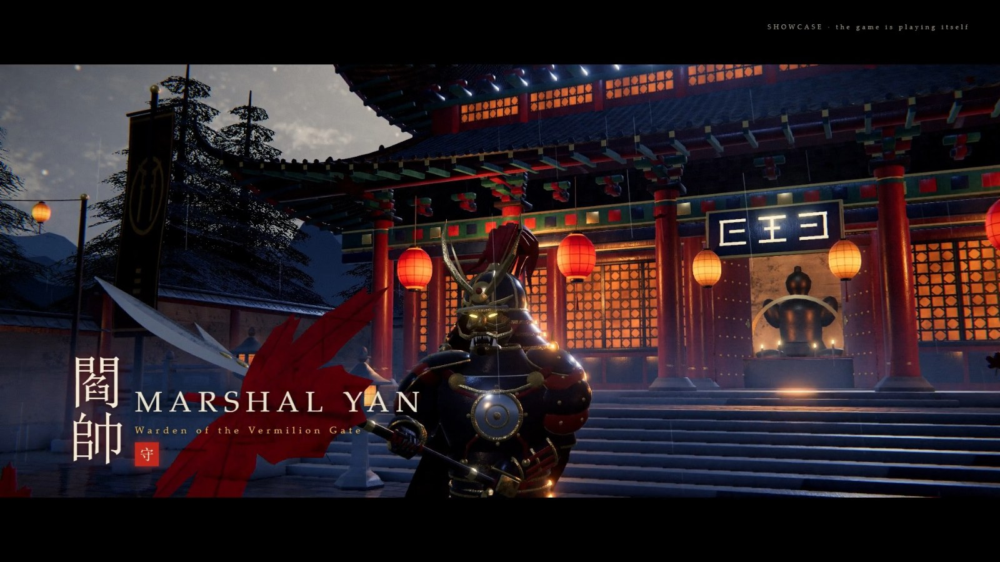
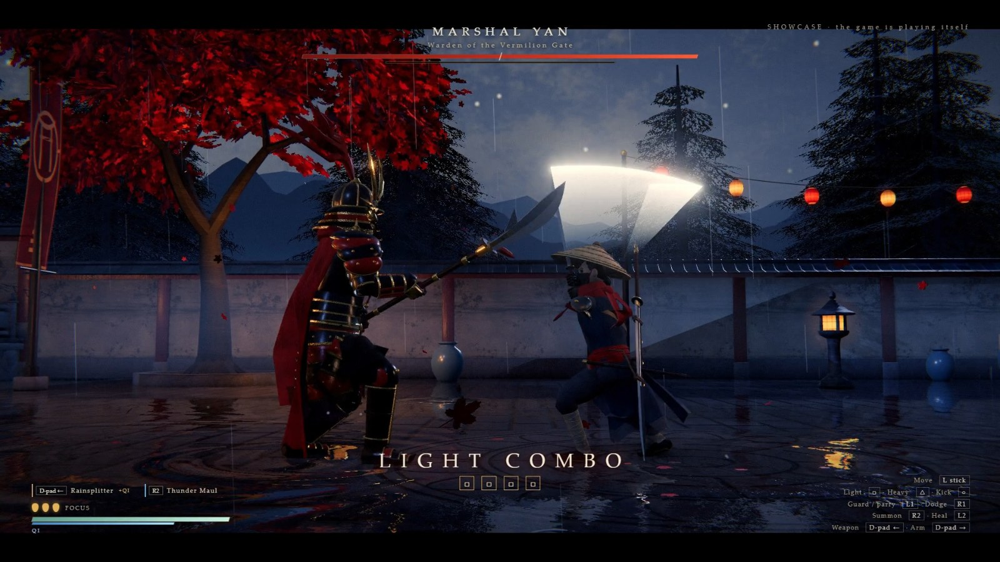
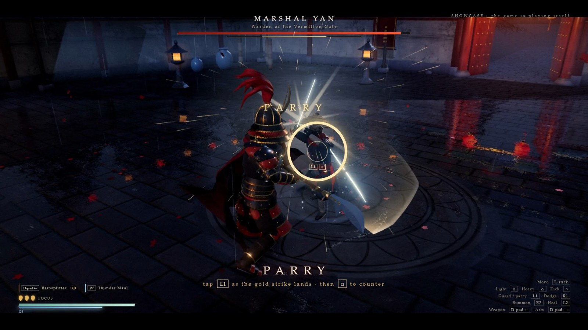
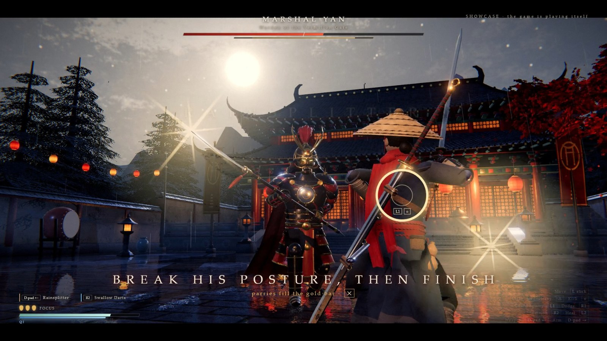
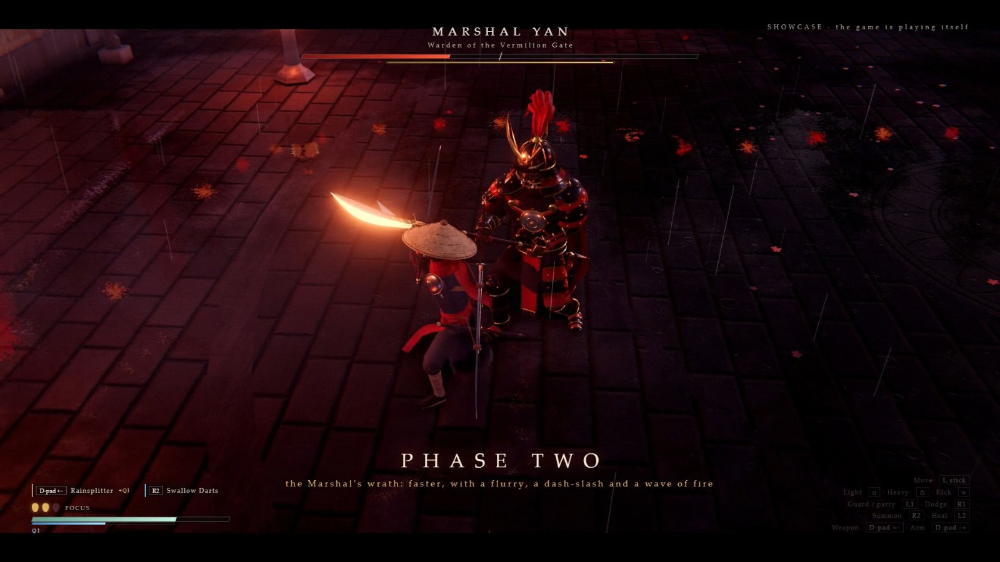
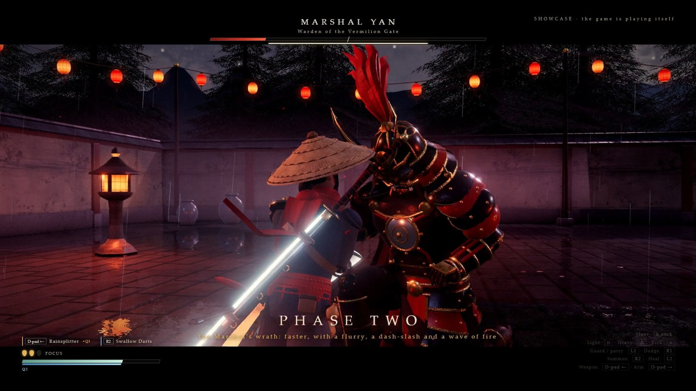

# Vermilion Gate

A third-person sword duel in the browser, in the style of *Phantom Blade Zero*'s boss fights: a lone swordsman against
Marshal Yan, a two-phase glaive master, in a rain-soaked shrine courtyard.

**Play it: https://vermilion.fbp.dev** (keyboard and mouse, a DualSense / DualShock / Xbox controller, or touch on a phone in landscape)

Everything here was written by an AI model (Claude, "Fable") in one working session from plain-language requests:
the game code, every 3D model, every texture and every animation. Nothing was downloaded or hand-made. The art and
animation are generated by Python scripts that drive Blender headlessly, and the sound is synthesised in the browser.



| | |
|---|---|
|  |  |
|  |  |



**Video:** [two-minute showcase, the game playing itself (MP4, 63 MB, no sound)](docs/showcase-720p.mp4). The same
showcase runs live from the title screen ("Watch the showcase").

> This is an original fan-made tribute. It is not affiliated with or endorsed by S-GAME, and it contains no code,
> art, audio, characters or names from *Phantom Blade Zero*. The control layout and combat ideas follow the genre.

## What is in the fight

- **Two phases.** At half health the Marshal enrages: the courtyard turns red and he adds a five-cut flurry,
  a dash-through slash and a wave of fire along the ground.
- **Read the blade.** A gold glint means the strike can be guarded or parried; a red glint means it must be dodged.
  A ring closes round your fighter to show the moment.
- **Posture and finishers.** Parries and hits fill his gold posture bar. When it breaks he drops to one knee and a
  three-hit cinematic finisher is open.
- **Two weapons, switched mid-combo.** A fast sabre (Rainsplitter) and a heavy greatsword (Mountain-Cleaver), each
  with its own combo graph on light / heavy / kick.
- **Summoned arms.** A spectral maul smash and a fan of thrown blades, paid for with qi.
- **Qi.** One resource for heavy moves, summons and guarded hits; it returns on light hits, parries and perfect dodges.
- **Perfect dodge and counter.** Dodging through a strike slows time; a parry or perfect dodge powers the next attack.
- **Kick.** After a few hits he guards and counters; a kick knocks the guard aside.
- **Phones and tablets.** Full touch controls in landscape: a floating stick under the left thumb, action buttons under
  the right, and the weapon, arm and heal panels are tappable. Portrait shows a turn-your-device notice.
- **Full controller support** with rumble, analogue movement, button hints that follow the device in use, and
  menus driven from the pad.
- **Two difficulties.** *Master* (default) has a 0.13 s parry window, short dodge invulnerability, heavy hits, a boss
  whose swing tempo varies, and death restarts the duel. *Disciple* is forgiving. Toggle on the title screen.

## Controls

| Action | DualSense / DualShock | Xbox | Keyboard / mouse |
|---|---|---|---|
| Move | left stick (light tilt walks) | left stick | W A S D |
| Light attack | Square | X | Left click / J |
| Heavy attack (spends qi) | Triangle | Y | Right click / K |
| Kick, or the timed answer inside the closing ring | Circle | B | E |
| Guard (hold), parry (tap just before the hit) | L1 | LB | Shift / Q |
| Dodge (brief invulnerability) | R1 | RB | Space |
| Summoned arm (spends qi) | R2 | RT | F / middle click |
| Switch weapon (refills qi every 10 s) | D-pad left | D-pad left | Left arrow / Tab |
| Switch summoned arm | D-pad right | D-pad right | Right arrow |
| Focus: heal, 3 uses | L2 or D-pad up | LT or D-pad up | R / Up arrow |
| Finisher on a kneeling boss | Cross (or any attack) | A | V (or any attack) |
| Nudge camera / reset | right stick / R3 | right stick / RS | |
| Pause | Options | Menu | Esc / P |

Combos, sabre: `L L L L` · `L H` twin cut · `L L H` rising cut · `H` thrust · dodge then `L` draw-cut · `K` into `L` / `H`.
Greatsword: `L L L` (ends in a ground slam) · `L H` launcher · `H` charged slam · dodge then `L` / `H`.

In a normal browser tab, sound stays off until one click or key press (controller buttons do not count for that).

## Run it locally

Needs Node 20+ and a recent Chrome or Edge.

```
npm install
node server.js 5260
```

Then open http://localhost:5260/. On Windows, `Play_VermilionGate.bat` starts the server and opens the game as a
full-screen window with its own browser profile, so sound and rumble work straight from the controller.

Query flags: `skip=1` no intro · `demo=1` showcase · `auto=1` a bot plays (`bot=0..1` parry skill) · `god=1` ·
`phase=2` · `hp=0.55` boss health fraction · `q=0..2` quality · `diff=standard|master` · `glyphs=ps|xbox|kbm`

## How it is built

| Part | Where |
|---|---|
| Game loop, camera, cinematics | `game/src/main.js` |
| Player: combo graph, qi, weapons, guard / parry / dodge | `game/src/hero.js` |
| Boss AI and attack table | `game/src/boss.js` |
| Rig playback, root motion, cloth springs | `game/src/actor.js` |
| Effects (trails, sparks, afterimages, summons) | `game/src/fx.js` |
| Arena rendering, wet-floor reflection, rain, post-processing | `game/src/env.js` |
| Keyboard, mouse and gamepad input | `game/src/input.js` |
| Self-playing showcase | `game/src/demo.js` |
| Difficulty numbers | `game/src/tuning.js` |
| Synthesised sound | `game/src/audio.js` |

Rendering is [three.js](https://threejs.org/). The art pipeline is in `tools/` and runs under Blender 5.2 with no
user interface:

```
blender -b -P tools/textures.py        # arena textures, sky
blender -b -P tools/textures_char.py   # character textures
blender -b -P tools/build_arena.py     # game/assets/arena.glb
blender -b -P tools/build_hero.py      # game/assets/hero.glb + hero_meta.json (clips: tools/hero_clips.py)
blender -b -P tools/build_boss.py      # game/assets/boss.glb + boss_meta.json (clips: tools/boss_clips.py)
```

Animations are written as key poses (body angles plus hand, foot and weapon targets); `tools/rigkit.py` solves the
limbs on every frame and bakes 49 clips, including root motion so feet stay planted.

## Tests

- `node tools/play.mjs "auto=1" run 10000,10000`: a bot plays in headless Chrome; saves screenshots, prints the state.
- `node tools/pad_test.mjs`: drives the game through a simulated DualSense.
- `node tools/input_test.mjs`: drives it with real keyboard and mouse events.
- `node tools/touch_test.mjs`: drives it as a phone in landscape with multi-touch events.
- `node tools/capture.mjs` then `blender -b -P tools/encode_video.py`: records the showcase frame by frame.

Honest limits: it was balanced against a bot rather than by long human play-testing, touch play was checked in a
phone-sized emulation rather than on many real devices (older phones may run it slowly), faces are simple up close, and
cloth can clip through legs in deep lunges.

## Licence

MIT, see [LICENSE](LICENSE).
